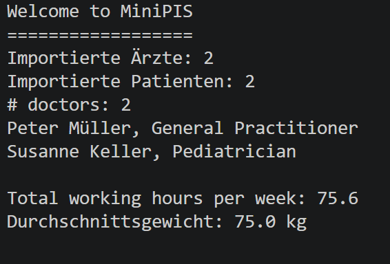

# MiniPIS

A playground for developing a simple Patient Information System (PIS), sometimes also called a Practice Information System.

## My Implementation

I extended the MiniPIS project with the following features:

- **Doctor:** Added employment validation and an email address with Regex validation.
- **Patient:** Created a new class with height, weight, birth date, calculated age and sex.
- **Person:** Created a superclass for Doctor and Patient to reuse common attributes and methods.
- **Appointment:** Created a class for appointments between doctors and patients.
- **Data Analysis:** Calculated the average weight and height of patients.
- **CSV Export:** Exported doctor and patient data into separate CSV files.
- **JSON Export:** Added functionality to export doctors and patients into JSON files.
- **JSON Import:** Added functionality to import doctors and patients from JSON files.
- **Demo Data:** Created sample doctors, patients and appointments.

## How to Run

Open the MiniPIS project in Visual Studio Code and run `MiniPIS.java`.

The JSON functionality requires the `org.json` library, which is included as a JAR file in the `lib` folder.

The program creates sample data, calculates statistics and exports the following files:

**CSV files:**
- `doctors.csv`
- `patients.csv`

**JSON files:**
- `doctors.json`
- `patients.json`

The program also imports the JSON files and displays the number of imported doctors and patients.

## Example Output

The following screenshot shows the program output in the terminal.

---

# Original MiniPIS Project Description

## MiniPIS Template

MiniPIS contains a starting template that covers a Patient Information System (PIS) for a group practice.

MiniPIS is very simplistic:

- It is not a template for a real PIS implementation, but intended for learning OOP with Java.
- It has no user interface, only programmatically created and tested data.
- It provides no built-in database persistence.

The template handles the doctors working at the practice.

The project contains a Java class for representing a Doctor.

There are methods to create data, process data, and analyse data.

Study the template and then start to add new functionality according to the following requirements.

## New Requirements

Implement new functionalities according to the listed requirements. The requirements are mainly keywords; it is up to you to interpret and make sense of them. Develop new classes, create sample objects, process them, and analyse the results.

### Clarified Requirements and Tasks

- Doctor: add missing setter for employmentLevel
- Doctor: validate employmentLevel in setter method
- Doctor: add email address
- (Optional) Doctor: validate email in setter method
  - Hint: use regular expression for validation
- Add Patient to MiniPIS project
  - Develop a new class
  - Create demo data
- Patient: add weight and height
- Patient: add birth date and age
  - Hint: what could be an attribute, what a method?
  - Hint: check LocalDate in Java Documentation
- Patient: add sex
- Refactor Doctor and Patient classes
  - Hint: reuse common fields and methods in a superclass
- Calculate average weight and height of patients
- Add Appointment to MiniPIS project
  - Develop a new class
  - Create demo data
- Export Patients and Doctors as CSV files (take the TSV file exporting Doctors as a starting point and adapt it to CSV)
- Optional: write JUnit test case(s)

### Unclear Requirements

Many missing concepts have been named by potential users of MiniPIS, but are not prioritized:

- Lab Test
- Assistant
- Diagnosis
- Prescription
- Drug
- Therapy
- Medication
- Nurse
- Bill
- ...

Prioritize, design and further develop MiniPIS according to your judgement of feature and function relevance.